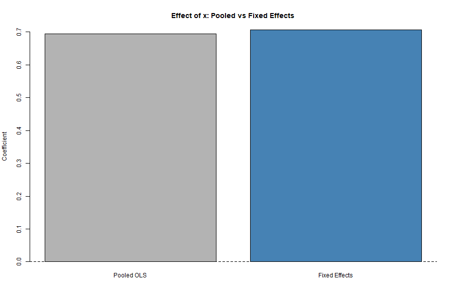

# Panel Data and Fixed Effects

::: {.callout-tip}
### Learning Objectives
- Understand why panel data are useful in applied econometrics
- Learn how fixed effects control for time-invariant unobserved heterogeneity
- Interpret coefficients from fixed effects models correctly
:::

::: {.callout-important}
### Key Takeaways
- Fixed effects models exploit within-unit variation over time
- Time-invariant characteristics are differenced out in fixed effects estimation
- Fixed effects improve causal interpretation under weaker assumptions
:::

::: {.callout-warning}
### Common Pitfalls
- Interpreting fixed effects coefficients as between-unit effects
- Including time-invariant regressors in fixed effects models
- Ignoring serial correlation or clustering in panel data
:::

## Motivation

## Fixed Effects vs. Pooled OLS

Why panel data and fixed effects matter in applied econometrics.

## Model

Formal setup and identifying assumptions.

## Interpretation

How to interpret estimates in practice.

