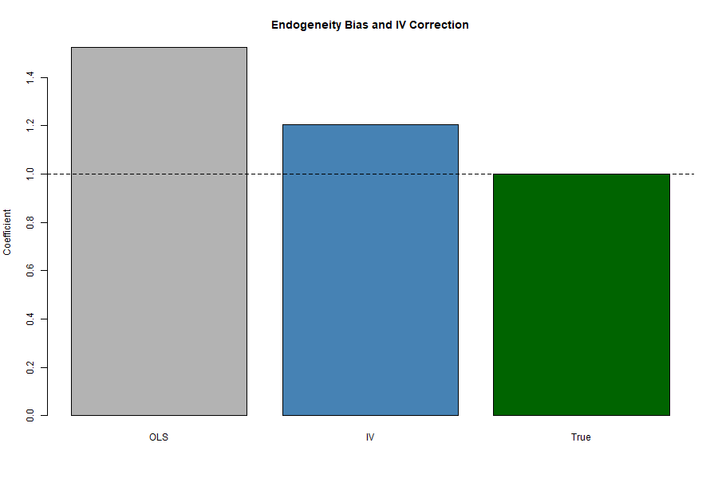

# Instrumental Variables

::: {.callout-tip}
### Learning Objectives
- Understand why endogeneity arises in regression analysis
- Learn the conditions required for a valid instrumental variable
- Interpret instrumental variables estimates correctly
:::

::: {.callout-important}
### Key Takeaways
- Instrumental variables address endogeneity by isolating exogenous variation
- Valid instruments must satisfy relevance and exclusion restrictions
- IV estimates often differ from OLS due to different identifying variation
:::

::: {.callout-warning}
### Common Pitfalls
- Using weak instruments that lead to biased inference
- Confusing statistical significance with instrument validity
- Interpreting IV estimates without considering the local average treatment effect
:::

## Motivation

Why instrumental variables matter in applied econometrics.

## Model

Formal setup and identifying assumptions.

## Interpretation

How to interpret estimates in practice.

The figure compares OLS and IV estimates in the presence of endogeneity.
OLS overstates the causal effect because the regressor is correlated with the error term.
IV estimation corrects this bias by using only exogenous variation induced by the instrument.

## Empirical example

The empirical implementation of instrumental variables is demonstrated using simulated data in the accompanying application.

