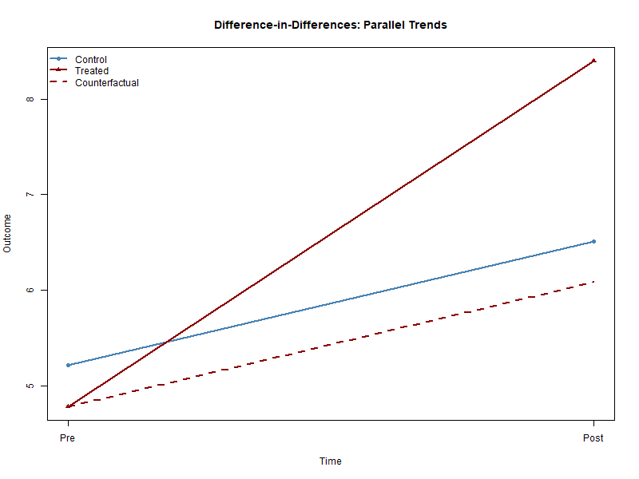

# Difference-in-Differences

::: {.callout-tip}
### Learning Objectives
- Understand the logic of Difference-in-Differences estimation
- Recognize the parallel trends assumption
- Interpret DiD estimates as causal effects under appropriate conditions
:::

::: {.callout-important}
### Key Takeaways
- DiD identifies causal effects using changes over time between treated and control groups
- The validity of DiD hinges on the parallel trends assumption
- Fixed effects DiD is a special case of panel regression
:::

::: {.callout-warning}
### Common Pitfalls
- Violations of parallel trends
- Anticipation effects and dynamic treatment timing
- Misinterpretation of two-way fixed effects estimates
:::

## Motivation

Why comparing before–after differences across groups can identify causal effects.

## Setup

The basic two-group, two-period Difference-in-Differences framework.

## Identification

The parallel trends assumption and its implications.

## Interpretation

The figure illustrates the logic of Difference-in-Differences.
Absent treatment, treated and control groups would have followed parallel trends.
The DiD estimator is the vertical difference between the observed and counterfactual outcomes.

How to interpret the DiD estimator in practice.

## Empirical example

The empirical implementation of Difference-in-Differences is demonstrated using simulated data in the accompanying application.

